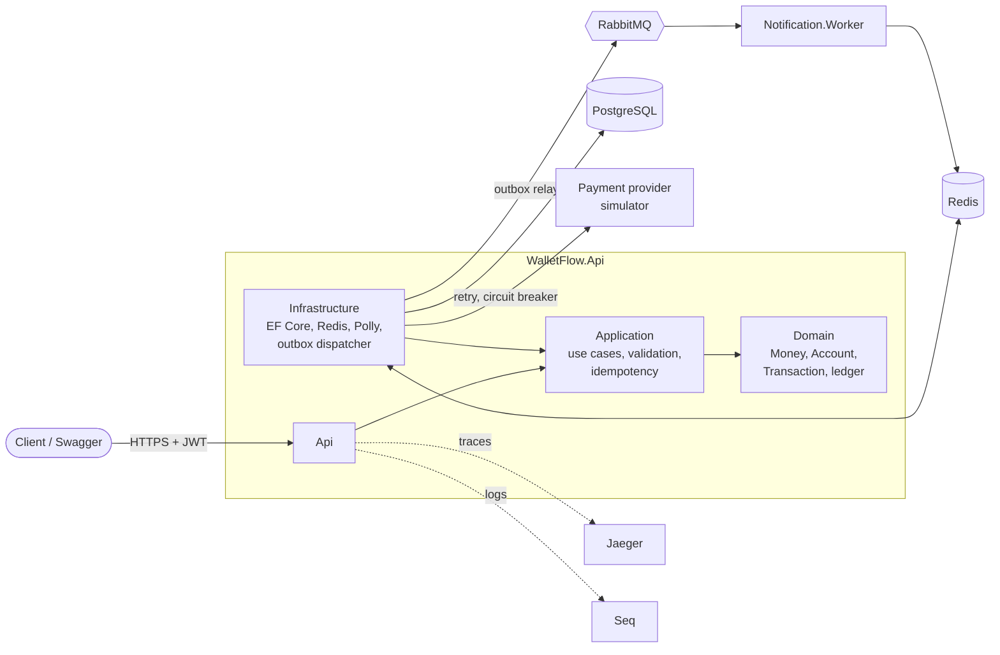
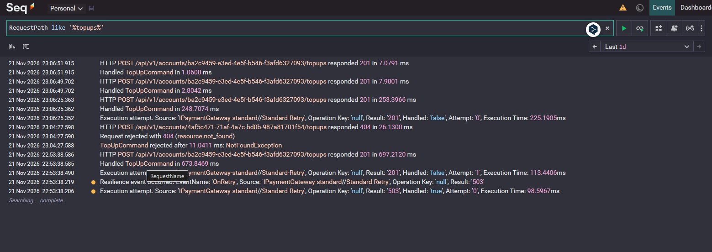
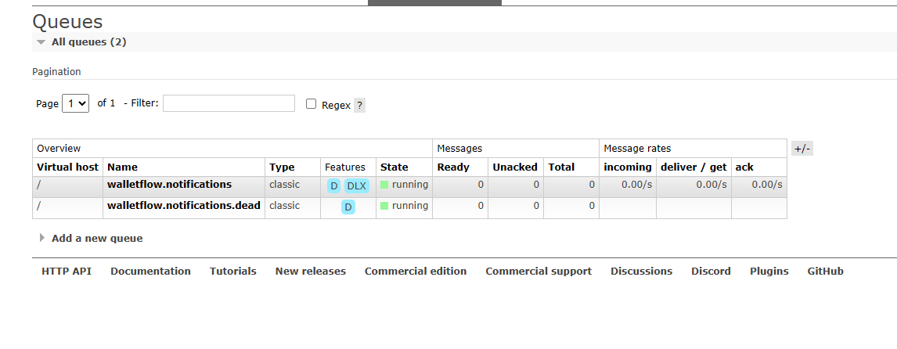
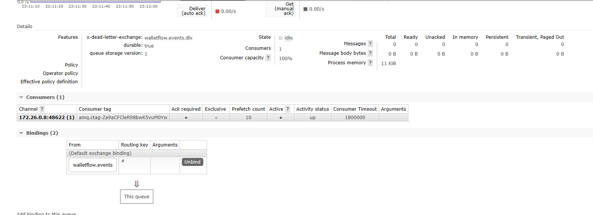
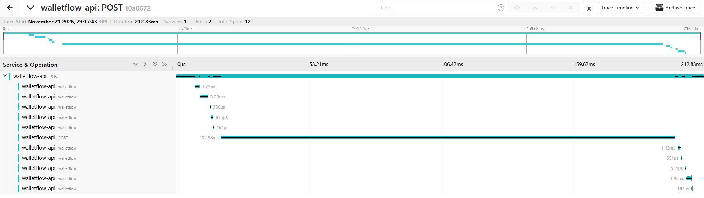

# WalletFlow

[](https://github.com/elifbarlik/WalletFlow/actions/workflows/ci.yml)
[](https://github.com/elifbarlik/WalletFlow/actions/workflows/codeql.yml)


A digital-wallet and money-transfer REST API built to show how enterprise backends solve **consistency under
concurrency, retry-safe payments, secure authentication, resilient integrations and reliable event delivery**.
Stack: .NET 8, Clean Architecture, PostgreSQL, Redis, RabbitMQ, OpenTelemetry, Docker. All data is fictional.

## Architecture



**A transfer, step by step:** the request is validated → its `Idempotency-Key` is reserved in Redis → one PostgreSQL
transaction debits, credits, writes the ledger rows, an outbox event and an audit entry → the response is stored for
replays → the outbox dispatcher publishes the event to RabbitMQ → the worker sends the notification once.

## Backend technologies: why and how

| Technology | Why it is used | How it is used |
|---|---|---|
| **ASP.NET Core 8 Web API** | Mainstream enterprise stack, fast, first-class DI and middleware | Thin controllers, API versioning (`/api/v1`), RFC 7807 problem responses, Swagger/OpenAPI with JWT |
| **Clean Architecture + CQRS (MediatR)** | Business rules must be testable without a database or web server | Domain → Application → Infrastructure/Api, dependencies pointing inward; each use case is one request + handler |
| **MediatR pipeline behaviors + FluentValidation** | Keep cross-cutting concerns out of handlers | Logging → validation → idempotency run around every command |
| **PostgreSQL + EF Core 8** | A wallet needs real ACID transactions | One transaction per transfer; `xmin` optimistic concurrency with retry; `CHECK (balance >= 0)`; migrations (applied under an advisory lock so replicas cannot race) |
| **Double-entry ledger** | Money must be traceable and auditable | Every movement writes balanced debit/credit rows; a balance always equals the sum of its entries |
| **Idempotency (Redis + derived ids)** | Clients retry; money must never move twice | `Idempotency-Key` header; Redis `SET NX EX` reserves the key and replays the stored response. The transaction id is derived from the key, so the primary key blocks a duplicate **even if Redis loses all data** |
| **Redis** | Shared, fast, atomic state across instances | Idempotency keys, rate-limit counters (Lua script) so limits hold across replicas, and the worker's deduplication inbox. Never the source of truth. `IDEMPOTENCY_PROVIDER=Postgres` runs without it |
| **JWT + refresh tokens + PBKDF2** | Stateless, short-lived access with revocable sessions | 15-minute access tokens; opaque refresh tokens stored hashed and rotated, reuse revokes the family; 210k-iteration PBKDF2; lockout after 5 failures; roles `Customer`/`Admin`/`Auditor`; another user's account answers 404 |
| **ASP.NET rate limiting** | Brute-force and abuse protection | Global, strict per-IP on auth, per-user on money endpoints; counters in Redis when available |
| **Polly (Microsoft.Extensions.Http.Resilience)** | The external payment provider is unreliable | Typed `HttpClient` with retry + jitter, circuit breaker and timeouts. The same payment id is sent as the provider's idempotency key, so a retried top-up cannot charge twice |
| **Transactional outbox** | A committed transfer must never lose its event | Events are written in the same DB transaction; a background dispatcher publishes them (`FOR UPDATE SKIP LOCKED`, at-least-once) |
| **RabbitMQ** | Decouple notifications from the request | Durable topic exchange, persistent messages, publisher confirms; `Notification.Worker` consumes with a dead-letter queue and a Redis inbox, so redelivery never sends a duplicate |
| **Serilog + Seq** | Searchable, structured logs | JSON logs with correlation id and user id; payloads are never logged |
| **OpenTelemetry + Jaeger** | See where a request spends its time | Traces for ASP.NET Core, outgoing HTTP and Npgsql exported over OTLP |
| **Health checks** | Orchestrators need liveness/readiness | `/health/live`, `/health/ready` (PostgreSQL, Redis, payment provider) |
| **Docker + Compose** | One-command, reproducible environment | Multi-stage images, non-root, read-only filesystem, dropped capabilities; optional `messaging` and `observability` profiles |
| **GitHub Actions, CodeQL, Dependabot** | Quality and supply-chain gates | Build, tests with coverage, vulnerable-package check, image builds, compose smoke test |

## Testing technologies: why and how

| Tool | Why | How it is used |
|---|---|---|
| **xUnit + FluentAssertions** | Standard, readable assertions | All suites |
| **NSubstitute + in-memory test doubles** | Test handlers without infrastructure | Application tests run use cases against fake repositories, outbox and payment gateway |
| **Testcontainers (PostgreSQL, Redis)** | Mocks cannot prove transactions or atomic Redis operations | Integration tests start real containers; `WebApplicationFactory` hosts the real API |
| **NetArchTest** | Architecture rules rot silently | Fails the build if a layer depends on one it must not |
| **Coverlet + ReportGenerator** | Make coverage measurable | Coverage artifact and summary in CI |

| Suite | Tests | What it proves |
|---|---|---|
| Domain | 20 | Money rules, account and ledger invariants |
| Application | 41 | Handlers, validators, lockout, token reuse, idempotent replay without any key store |
| Architecture | 5 | The dependency rule between layers |
| Integration | 37 | Real API + PostgreSQL/Redis: auth and authorization, 20 concurrent transfers, overdraw race, Redis wiped then replayed, shared rate limiter, provider outage, outbox |

**103 tests, all passing; 85 % line coverage** (generated migrations excluded).

## Evidence from a running stack

**Seq**: structured request logs. The `Standard-Retry` lines show Polly at work: the payment provider answered `503`,
the call was retried and the second attempt returned `201`.



**RabbitMQ**: the notification queue with its dead-letter queue, bound to the `walletflow.events` exchange, one active consumer.

| Queues | Queue detail |
|---|---|
|  |  |

**Worker output**: the consumer receives the outbox event and sends the notification once.

```json
{"LogLevel":"Information","Category":"Notification.Worker.NotificationProcessor",
 "Message":"Notification sent for TopUpCompleted: 10.00 TRY (e0050a4e-d5dc-412d-96fb-6fab2a1f38ca)"}
```

**Jaeger**: one top-up request (213 ms, 12 spans). The long `POST` bar (183 ms) is the outgoing call to the payment provider; the short `walletflow` spans around it are the PostgreSQL queries before and after it.



## Quick start

Requires Docker (running).

```bash
bash scripts/init-env.sh        # Windows: powershell scripts/init-env.ps1   (generates .env with random secrets)
docker compose up -d --build    # api + postgres + redis + payment simulator
```

Swagger: <http://localhost:8080/swagger> · Health: <http://localhost:8080/health/ready>.
Demo users (passwords are in your `.env`): `demo@walletflow.test` (funded wallet), `admin@walletflow.test`, `auditor@walletflow.test`.

| Optional | Command | `.env` |
|---|---|---|
| RabbitMQ + worker | `docker compose --profile messaging up -d` | `MESSAGING_PROVIDER=RabbitMq` |
| Jaeger + Seq | `docker compose --profile observability up -d` | `OTEL_ENDPOINT=http://jaeger:4318`, `SEQ_URL=http://seq:5341` |

Jaeger <http://localhost:16686> · Seq <http://localhost:5341> · RabbitMQ <http://localhost:15672> (user `walletflow`, password `RABBITMQ_PASSWORD`).
Ready-made requests: [docs/api-examples.http](docs/api-examples.http). Try: send one transfer twice with the same
`Idempotency-Key`; use card token `tok_declined` for a `402`; stop `payment-simulator` for a `503`.

```bash
dotnet test      # Docker must be running; integration tests start PostgreSQL and Redis containers
```

## API (v1)

| Method | Route | Access |
|---|---|---|
| POST | `/auth/register`, `/auth/login`, `/auth/refresh` | anonymous |
| POST, GET | `/accounts`, `/accounts/{id}`, `/accounts/{id}/transactions` | owner |
| POST | `/accounts/{id}/topups` (`Idempotency-Key`) | owner |
| POST | `/transfers` (`Idempotency-Key`) | owner of the source account |
| PATCH | `/admin/accounts/{id}/status` | Admin |
| GET | `/admin/audit-logs` | Admin, Auditor |

Errors: `400` validation, `401`, `402` declined, `403`, `404`, `409` conflict, `422` business rule, `429`, `503`.

## Design notes

Short decision records in [docs/adr](docs/adr): [architecture](docs/adr/0001-clean-architecture-and-cqrs.md),
[concurrency & ledger](docs/adr/0002-optimistic-concurrency-and-ledger.md), [idempotency](docs/adr/0003-idempotency.md),
[outbox](docs/adr/0004-transactional-outbox.md), [security](docs/adr/0005-security-decisions.md), [Redis](docs/adr/0006-redis.md).

## Limitations

Notifications are logged, not sent through a real e-mail/SMS provider. No e-mail verification, MFA or JWT key rotation.
Not penetration-tested. Targets .NET 8, whose support ended in November 2026; moving to .NET 10 LTS is the next maintenance step.

MIT licensed, see [LICENSE](LICENSE). Fictional data only; not financial software.
